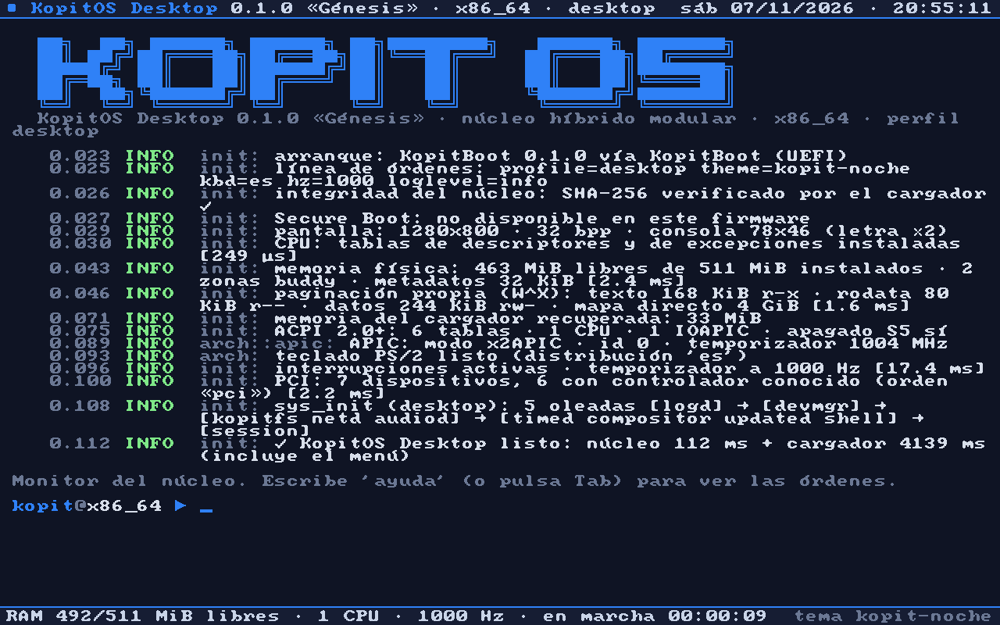
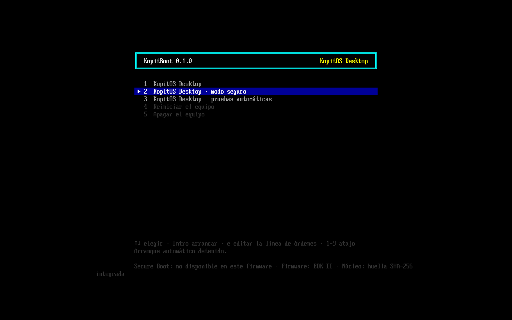
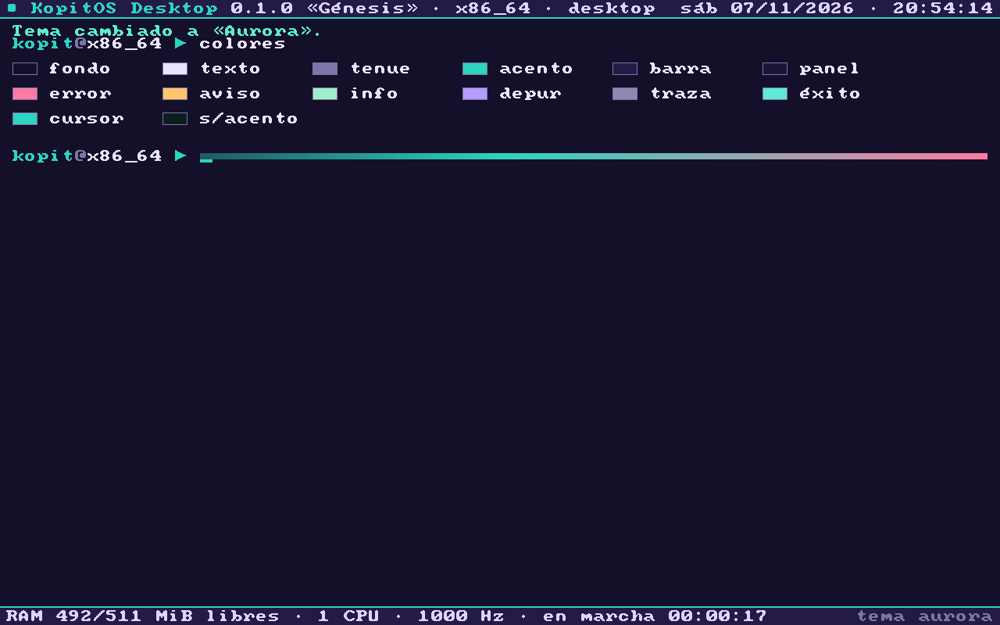

<h1 align="center">KopitOS</h1>

<p align="center">
  <b>Un núcleo, todas las CPU, todos los dispositivos.</b><br>
  Sistema operativo modular escrito desde cero en Rust · x86_64 · ARM64 · RISC-V
</p>

<p align="center">
  
</p>

KopitOS arranca en **x86_64** (UEFI, Multiboot2 o PVH), **ARM64** y **RISC-V** con el mismo
`kernel_main`, y se adapta a cada dispositivo (servidor, sobremesa, portátil, tableta, teléfono e
IoT) mediante **perfiles** que deciden qué se compila, cómo arranca y cómo se ve. Crear una
distribución derivada es escribir un archivo.

> **Fase 1, «Génesis».** Arranque, núcleo base y herramientas: todo lo que aparece abajo funciona y
> se prueba automáticamente en QEMU. Lo que viene después está en [ARCHITECTURE.md](ARCHITECTURE.md).

## ✨ Qué hay ya

| | |
|---|---|
| 🚀 **KopitBoot** | cargador UEFI propio: menú en español, edición de la línea de órdenes, **verificación SHA-256 del núcleo** con la huella dentro del cargador firmado, GOP, tablas de páginas con W^X |
| 🔀 **Cuatro rutas de arranque** | UEFI (disco GPT e ISO), **Multiboot2** (GRUB) y **PVH** (QEMU/Firecracker) con un trampolín 32→64 en ensamblador, y **device tree** (ARM64/RISC-V). Todas producen el mismo `BootInfo` |
| 🧠 **Memoria** | asignador **buddy por zonas** (DMA/DMA32/Normal), **paginación propia W^X** con página de guarda, mapa directo con páginas enormes, ventanas MMIO *write-combining* y montículo slab |
| ⚡ **Interrupciones** | GDT/TSS con pilas IST, IDT de 256 vectores, **x2APIC/xAPIC + IOAPIC**, ACPI (MADT, FADT, apagado S5), GICv2 en ARM64, SBI en RISC-V |
| 🖥️ **Consola** | gráfica con barras de estado, **escala adaptativa**, doble búfer, fuente propia con **todas las letras del español**, 6 temas intercambiables en caliente; VGA de texto para BIOS |
| 📝 **Registro** | niveles, destinos con nivel propio, anillo `dmesg` de 64 KiB, ruta de emergencia para pánicos |
| ⌨️ **Monitor del núcleo** | más de 20 órdenes (`info`, `mem`, `pci`, `acpi`, `cpu`, `tema`, `servicios`...), teclado PS/2 **español** con tildes, o por el puerto serie |
| 🧩 **Controladores aislados** | no dependen del núcleo: el mismo controlador 16550 atiende el COM1 de un PC y la UART de RISC-V. Registro de controladores con fase de la hoja de ruta |
| 📦 **distro_builder** | perfiles con herencia → imagen **GPT/FAT32** e **ISO híbrida** (CD y USB) escritas desde cero, sin `mtools` ni `xorriso`; QEMU; pruebas |
| ✅ **Pruebas** | 59 pruebas en el anfitrión + **pruebas de humo dentro del núcleo** en 5 configuraciones de QEMU |

<p align="center">
  
  
</p>

## 🏁 Empieza en dos órdenes

Necesitas **Rust** ([rustup](https://rustup.rs)) y **QEMU**. La versión exacta de Rust y los
objetivos bare-metal se instalan solos gracias a `rust-toolchain.toml`.

```sh
git clone <este repositorio> && cd KopitOS
cargo kopit run
```

Se abre QEMU con KopitBoot; tras el menú, KopitOS arranca y el monitor del núcleo queda esperando
órdenes **en la ventana y en tu terminal** (consola serie). Escribe `ayuda`.

| Sistema | QEMU | Firmware UEFI |
|---------|------|---------------|
| Windows | [qemu.org](https://www.qemu.org/download/#windows) o MSYS2 (`pacman -S mingw-w64-ucrt-x86_64-qemu`) | viene con QEMU (`edk2-x86_64-code.fd`) |
| Debian/Ubuntu | `sudo apt install qemu-system-x86 qemu-system-arm qemu-system-misc` | `sudo apt install ovmf` |
| macOS | `brew install qemu` | viene con QEMU |

`cargo kopit doctor` comprueba qué ha encontrado la herramienta. Si algo está en un sitio raro,
indícalo con `KOPIT_QEMU`, `KOPIT_OVMF_CODE` y `KOPIT_OVMF_VARS`.

## 🧰 Órdenes

```sh
cargo kopit run                                  # UEFI desde disco GPT (por defecto)
cargo kopit run --boot iso                       # UEFI desde la ISO híbrida
cargo kopit run --boot pvh --headless            # arranque directo, sólo consola serie
cargo kopit run --arch riscv64                   # RISC-V (OpenSBI, QEMU virt)
cargo kopit run --arch aarch64                   # ARM64 (EL1, QEMU virt)
cargo kopit run --profile server                 # otro perfil
cargo kopit run --cmdline "theme=ambar fbcon.scale=3 loglevel=debug"
cargo kopit image --release                      # target/kopitos/x86_64/desktop/*.img
cargo kopit iso --release                        # ISO para CD o USB
cargo kopit test                                 # pruebas del anfitrión + humo en QEMU (x86_64)
cargo kopit test --arch aarch64                  # ... y en ARM64 / riscv64
cargo kopit profiles                             # perfiles disponibles
cargo kopit new-distro mi-distro --from desktop --name "Mi Distro"
cargo kopit addr2line ffffffff80201234           # traza de un pánico → funciones
```

En Linux, macOS o WSL también hay `make` (`make run`, `make iso PROFILE=server`, `make test-all`...).

## 🗂️ El proyecto

```text
boot/        protocol (KBP: el contrato cargador → núcleo) · kopitboot (cargador UEFI)
kernel/      núcleo portable: init, memoria, registro, consola, tiempo, ACPI, PCI, shell, pruebas
arch/        x86_64 · aarch64 · riscv64 (se compilan dentro del núcleo, como en Linux)
drivers/     api · serie (16550, PL011) · vídeo (framebuffer) · entrada (PS/2) · bus (PCI)
libs/        buddy · crypto (SHA-256, CRC32) · elf · fdt (device tree)
ui/          theme (6 temas) · font (Scale2x + español) · compositor (daños, capas, oclusión)
sys_init/    grafo de servicios con arranque paralelo por oleadas
distro_builder/  la herramienta `kopit`: perfiles, FAT, GPT, ISO, QEMU, pruebas
profiles/    base · desktop · laptop · server · tablet · phone · iot
docs/        protocolo de arranque, distribuciones derivadas, capturas
```

## 🧬 Distribuciones derivadas

```sh
cargo kopit new-distro aurora-os --from desktop --name "Aurora OS"
cargo kopit run --profile aurora-os
```

Hereda todo y cambia sólo lo que quieras: nombre, tema y colores de marca, teclado, resolución,
qué subsistemas se compilan y archivos propios en la imagen. Guía completa en
[docs/distribuciones.md](docs/distribuciones.md).

## 🔬 Pruebas

```text
▶ Pruebas unitarias en el anfitrión
  ✓ cargo test                59 pruebas superadas
▶ Pruebas de humo en QEMU
  ✓ UEFI · disco GPT · CPU max (x2APIC)        2.6 s  KOPIT-SMOKE: OK (6/6 pruebas)
  ✓ UEFI · ISO híbrida · CPU qemu64 (xAPIC)    2.4 s  KOPIT-SMOKE: OK (6/6 pruebas)
  ✓ PVH · arranque directo (sin UEFI)          0.5 s  KOPIT-SMOKE: OK (6/6 pruebas)
  ✓ riscv64 · QEMU virt · OpenSBI → modo S     0.3 s  KOPIT-SMOKE: OK (6/6 pruebas)
  ✓ aarch64 · QEMU virt · EL1 · GICv2          0.3 s  KOPIT-SMOKE: OK (6/6 pruebas)
```

Dentro del núcleo se comprueban: la excepción de depuración con retorno, el buddy alineado, el
montículo (`Vec`, `Box`, `String`, `BTreeMap`), W^X y la página de guarda, la llegada de tics y los
planes de sys_init de las 6 clases de dispositivo.

## 📚 Documentación

- [ARCHITECTURE.md](ARCHITECTURE.md): arquitectura, decisiones y **hoja de ruta** (controladores,
  compatibilidad, distribuciones, planificador heterogéneo, memoria predictiva, KopitFS, GPU).
- [docs/protocolo-arranque.md](docs/protocolo-arranque.md): especificación de KBP.
- [docs/distribuciones.md](docs/distribuciones.md): cómo crear tu distribución.

## 📄 Licencia

[MIT](LICENSE) © 2026 Adrián Cueva Caravaca. La fuente base de la consola es `font8x8` de
Daniel Hepper (dominio público).
